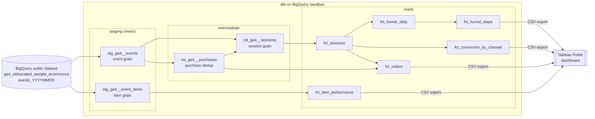

# GA4 E-commerce Analytics | BigQuery · dbt · Tableau

End-to-end analytics engineering project that turns raw Google Analytics 4 event
data into tested, analysis-ready data marts for e-commerce performance reporting.

It is built on Google's public GA4 e-commerce sample dataset (4.3 million events).
The pipeline models user sessions, conversion funnels, acquisition channels,
transactions and product performance.

### Business objectives
- Find the conversion bottlenecks between viewing a product and purchasing it.
- Compare acquisition channels by traffic, conversion rate and revenue.
- Analyze purchasing behavior across devices and new vs returning users.
- Find products with high engagement but low add-to-cart conversion.

### Engineering highlights
- **Data transformation:** modular dbt models in staging, intermediate and mart layers.
- **Data modeling:** session-, transaction- and item-level fact tables, each with an explicit grain.
- **Data quality:** dbt tests for uniqueness, completeness, referential integrity, funnel
  consistency, exact revenue reconciliation between sessions and orders, and no double
  counting of item sales.
- **Analytics delivery:** Tableau-ready datasets for funnel, channel, device and product analysis.

> **Verified on BigQuery:** a full `dbt build` over all 92 days (4,295,584 events →
> 360,129 sessions → 4,466 orders) passes **76 of 76 checks** (10 models, 66 data tests).
> See [Verification status](#verification-status) and [docs/run_report.md](docs/run_report.md).

**Data source:** Google Merchandise Store GA4 public sample,
`bigquery-public-data.ga4_obfuscated_sample_ecommerce` (Nov 2020 to Jan 2021).
The data is obfuscated. This project demonstrates analytics engineering methods,
not the store's real business performance.

## Architecture



| Model | Grain | Purpose |
|-------|-------|---------|
| `stg_ga4__events` | event | Flattens `event_params`, builds `session_key` |
| `stg_ga4__event_items` | event × item | Unnests the `items` array for e-commerce events |
| `int_ga4__purchases` | purchase event | Flags each purchase as `counted`, `duplicate` or `missing_transaction_id` |
| `int_ga4__sessions` | session | Session source, landing page, observed funnel events, order revenue |
| `fct_sessions` | session | Channel group, attribution basis, observed and inferred funnel flags |
| `fct_funnel_daily` | date × channel × device | Observed and inferred session counts per funnel step |
| `fct_funnel_steps` | date × channel × device × step | Long format for Tableau funnel charts |
| `fct_conversion_by_channel` | channel | Step conversion rates, AOV, revenue per session, traffic and revenue share |
| `fct_orders` | transaction | One row per counted transaction |
| `fct_item_performance` | item | Product funnel: views, carts, checkouts, units, revenue |

## Methodology

### Identifiers and placeholders
The sample's documentation says fields can hold `<Other>`, `NULL` or `''` because of
obfuscation. GA4 itself uses `(not set)`. For identifiers (`user_pseudo_id`,
`transaction_id`) all of these become NULL. Otherwise one placeholder such as `<Other>`
would merge many unrelated transactions into a single "order".

**Session key:** `sha256` of the JSON struct `{user_pseudo_id, ga_session_id}`.
- It is NULL unless both parts are present; events without them are excluded from the session models.
- JSON encoding is used instead of joining with a delimiter, so two different pairs can
  never produce the same key.
- `ga_session_id` alone is a start timestamp, so it is not unique across users.

### Session attribution (an approximation)
GA4 decides a session's attribution from the inputs on its `session_start` event
(UTMs, gclid, referrer), using **non-direct last click** across sessions. This 2020–21
export has no field holding that final result: checked on the real export, its only
traffic field is `traffic_source` (no `session_traffic_source_last_click` or
`collected_traffic_source`). So this project reconstructs a per-session channel and
labels it as an approximation:

| | |
|---|---|
| **Fields used** | The `source`, `medium` and `campaign` keys of `event_params`, with blank values treated as NULL |
| **Rule** | Use the values on the session's `session_start` event. If it has none, use the earliest event in the session that logged a source or medium. |
| **`attribution_basis`** | Records which case applied: `session_start_params`, `other_event_params` or `not_logged` |
| **Missing ≠ Direct** | Sessions with nothing logged get the channel `Unattributed (not logged)`. `Direct` is used only when the session explicitly logged source `(direct)`. |
| **Obfuscated values** | `Unattributed (obfuscated)` when the medium is `<Other>` / `(data deleted)`, or when there is no medium and the source is obfuscated. An obfuscated source with a known medium is still classified by the medium (`<Other> / organic` → Organic Search). |
| **Search engines** | Matched as whole host names (`google`, `www.google.com`, `bing`, ...), never as substrings |
| **Not used for channel** | `traffic_source.*` is the user's *first-touch* acquisition and never changes for that user. It is kept as `user_first_source` / `user_first_medium`. |
| **Difference from GA4 reports** | No cross-session lookback. A session that GA4 would credit to an earlier non-direct channel appears here as Direct or Unattributed. |

**Measured on the real data** ([`analyses/attribution_check.sql`](analyses/attribution_check.sql)):
- `session_start` events never carry source or medium in this export. Every attributed
  session uses the earliest other event (`attribution_basis = other_event_params`).
- 94,553 sessions (26%) logged no source or medium at all. These are real sessions with
  page views, mostly first visits, so they keep their own channel instead of becoming Direct.
- 66,366 sessions (18%) logged more than one source/medium, so choosing the earliest one
  affects the result.
- For 32% of attributed sessions, the session source differs from the user's first touch.
  That is why `traffic_source` is not used for the session channel.
- **Bug found and fixed by the first run:** the search-engine rule originally matched
  "google" anywhere in a source name. It classified the store's own domain
  (`shop.googlemerchandisestore.com`) and `analytics.google.com` as Organic Search,
  which inflated that channel by about 57k sessions.

### New vs returning users
- `user_type` is `new` when GA4's `ga_session_number` = 1, `returning` when it is > 1,
  and `unknown` when GA4 sent no session number. Unknown sessions are never guessed as new.
- `ga_session_number` counts sessions for the `user_pseudo_id` since its first visit, even
  visits before this data window. So a user whose earlier visits fall before
  November 2020 is still correctly marked returning.
- **Limitations:**
  - `user_pseudo_id` identifies a browser/device cookie, not a person. A person on two
    devices counts as two users.
  - Clearing cookies makes a returning visitor look new.
  - Consent or obfuscation gaps can leave the number missing.
- `has_first_visit` (whether the session has a `first_visit` event) is kept for
  cross-checking. A warn-level test flags sessions with more than one session number.
- On the real data, every session has a session number (0 `unknown`), and no session
  has more than one.

### Funnel: observed vs inferred
Steps: `session_start → view_item → add_to_cart → begin_checkout → purchase`.

- **Observed** (`has_<event>`, `sessions_observed`): GA4 logged that event in the session.
  These counts do not have to decrease from step to step. For example, a session can add
  to cart from a listing page without a `view_item` event.
- **Inferred** (`reached_<step>`, `sessions_inferred`): the session reached that step or
  a deeper one. A session that purchased is assumed to have passed checkout even if
  `begin_checkout` was not logged. This is an inference about progression, not observed
  checkout behavior. It is what makes the funnel monotonic, so step-to-step rates stay
  within 0–1.

The dashboard shows both counts side by side. The gap between them shows how much of
the funnel is inferred.

### Revenue and orders
GA4 can send the same purchase more than once, and some purchase events have no usable
`transaction_id`. GA4 has no event ID, so each purchase row gets a `purchase_event_key`:
a hash of its user, timestamp, bundle sequence ID, `ecommerce` record and `items` array.

**An order is (`transaction_id`, `user_pseudo_id`), not `transaction_id` alone.** The
first real run showed:
- All 314 transaction IDs repeated *by the same user* repeat the same revenue on the same
  day. These are true duplicates.
- All 15 transaction IDs shared *by different users* have different revenue on different
  dates. These are different orders whose IDs collided in the obfuscated sample.

Deduplicating on `transaction_id` alone would have dropped those 15 real orders.
`fct_orders` is keyed on `order_key`, and a monitoring test reports the number of reused IDs.

Deduplication happens in one place, `int_ga4__purchases`:

| `purchase_status` | Meaning | Counts as an order / revenue? | Real data |
|---|---|---|---|
| `counted` | Earliest row for an `order_key` (ties broken by `purchase_event_key`) | Yes | 4,466 rows, $308,830 (85.3%) |
| `duplicate` | Any other row of that order, including byte-identical copies | No | 320 rows, $21,518 (5.9%) |
| `missing_transaction_id` | NULL, `''`, `(not set)` or `<Other>`; cannot be deduplicated | No | 906 rows, $31,817 (8.8%) |

- **Precision:** the export stores money as FLOAT64. Revenue is cast to `NUMERIC` and
  rounded to cents in staging, so sums are exact and reconciliation needs no tolerance.
- **Missing revenue stays NULL**, not 0. A warn-level test reports counted orders without revenue.
- **One definition:**
  - Order and session revenue = `ecommerce.purchase_revenue_in_usd` of counted orders.
  - Item revenue = `items.item_revenue_in_usd` (price × quantity) of counted orders.
  - The two are different measures and are never added together or expected to be equal,
    because order revenue can include tax and shipping. On the real data they total
    $308,830 (orders) and $308,751 (items), and match exactly for 3,630 of 4,466 orders.
- **Orders without a session:** a purchase with no `ga_session_id` is still an order in
  `fct_orders`, with `has_session = false` and NULL channel and device. Only such orders
  are excluded from the session-revenue comparison. The real data has none.
- **Exact reconciliation test:** session transactions and revenue must equal those of
  orders that have a session, to the cent. Passes on the real data.
- **Consistency monitor (warn):** reports any order whose duplicate rows disagree on
  revenue. If they did, "keep the earliest row" would be a choice that changes revenue.
  The real data has none.

[`analyses/revenue_bridge.sql`](analyses/revenue_bridge.sql) breaks raw purchase revenue
down by status and session presence, and compares order revenue with item revenue.

### Item performance
- Views, add-to-carts and checkouts count **distinct sessions** per item, so repeated
  events in one session count once.
- Orders, units and revenue use only item lines from **counted** purchases. Each line
  (`purchase_event_key`, `item_index`) counts once, so duplicate purchase events and
  repeated rows cannot inflate item sales. A test checks the order counts against an
  independent count of distinct (item, counted order) pairs.
- 448 of 16,003 purchased item lines have no `item_revenue_in_usd` in the export. They
  count as units sold but add no item revenue.

## Data quality

| Check | Where |
|-------|-------|
| `unique` + `not_null` on every grain key (session, order, item, channel) | marts, intermediate |
| `unique_combination_of_columns` on funnel table grains | `fct_funnel_daily`, `fct_funnel_steps` |
| `accepted_values` on channel group, attribution basis, user type, device, funnel step, purchase status | marts, intermediate |
| `accepted_range`: conversion rates in [0, 1]; revenue, durations, engagement ≥ 0 | marts, intermediate, staging |
| Referential integrity: every order's session exists in `fct_sessions` | `fct_orders` |
| **Funnel consistency:** inferred counts never increase from one step to the next, for every date × channel × device | `tests/assert_funnel_is_monotonic.sql` |
| **Completeness:** session totals are identical across the three funnel models | `tests/assert_sessions_preserved_in_funnel.sql` |
| **Revenue reconciliation:** session transactions and revenue equal those of orders with a session, exactly | `tests/assert_session_revenue_equals_order_revenue.sql` |
| **No item double counting:** item order counts equal distinct (item, counted order) pairs | `tests/assert_item_sales_use_counted_orders_only.sql` |
| Monitors (warn): duplicate rows of one order that disagree on revenue; transaction IDs reused across users (warns above 50); counted orders without revenue; sessions with more than one session number; unexpected device values | tests + YAML |

## Verification status

All checks below were **executed** on 2026-11-20 against the BigQuery sandbox, dbt 1.12.7,
for the full sample (2020-11-01 to 2021-01-31).

| Check | Result |
|-------|--------|
| `dbt build`: 10 models + 66 data tests | **76 pass, 0 warn, 0 error** ([run report](docs/run_report.md)) |
| One-week development build (2020-12-01 to 12-07) | 74 pass, 0 warn, 0 error |
| All three `analyses/*.sql` run on BigQuery | All statements succeed |
| Row counts | 4,295,584 events → 360,129 sessions (270,154 users) → 4,466 orders; 1,393 items |
| Every event has a session key | Yes: 0 events without `user_pseudo_id` + `ga_session_id` |
| Cost | 17.5 GB billed per full build (76 queries, measured in `INFORMATION_SCHEMA.JOBS`), so about 57 full builds fit in the sandbox's free 1 TB/month |

The first real run exposed **two bugs that passed static review**, both now fixed and covered:
1. The channel rule matched "google" as a substring, so the store's own domain counted as
   Organic Search (see [Session attribution](#session-attribution-an-approximation)).
2. Deduplicating orders on `transaction_id` alone would have merged 15 different orders
   whose IDs collide across users (see [Revenue and orders](#revenue-and-orders)).

## Results

| Metric | Value |
|---|---|
| Sessions / users | 360,129 / 270,154 |
| Orders / revenue (counted) | 4,466 / $308,830 |
| Session conversion (any purchase event) | 1.35% (4,848 sessions) |
| Average order value | $69.15 |

The sample's revenue is in whole dollars and obfuscated, so these numbers show what the
pipeline produces, not the real store's performance.

## Findings

All numbers come from [`analyses/headline_insights.sql`](analyses/headline_insights.sql)
on the full build.

**1. The biggest drop is at the top: only 21% of sessions view a product.**

| Step | Sessions (inferred) | Sessions (observed) | From previous step |
|---|---:|---:|---:|
| Session start | 360,129 | 360,129 | |
| View item | 77,317 | 77,020 | 21.5% |
| Add to cart | 20,336 | 15,188 | 26.3% |
| Begin checkout | 11,109 | 11,106 | 54.6% |
| Purchase | 4,848 | 4,848 | 43.6% |

5,148 sessions (25% of the inferred add-to-cart step) reached checkout or purchase without
a logged `add_to_cart`. That is a tracking gap worth raising with whoever owns the GA4
implementation, and it is why observed and inferred counts are kept apart.

**2. Returning users convert about 4.5× better than new users, on every device.**
Conversion is 0.63–0.71% for new users and 3.05–3.18% for returning users, across
desktop, mobile and tablet. Device makes little difference at the same user type: desktop
and mobile are within 0.15 percentage points. Returning users bring 27% of sessions but
67% of revenue.

**3. Channel results depend on attribution quality more than on channel performance.**

| Channel | Share of sessions | Share of revenue | Conversion |
|---|---:|---:|---:|
| Organic Search | 28.6% | 31.9% | 1.61% |
| Unattributed (not logged) | 26.3% | 0.0% | 0.00% |
| Referral | 23.2% | 53.8% | 2.98% |
| Direct | 10.5% | 6.6% | 0.81% |
| Unattributed (obfuscated) | 8.8% | 6.1% | 1.00% |
| Paid Search | 2.1% | 1.0% | 0.61% |

- Referral looks like the best channel, but 56,491 of its 83,405 sessions and $99,005 of
  its $166,279 revenue come from the store's own domains (`shop.googlemerchandisestore.com`,
  `googlemerchandisestore.com`). Those look like self-referrals, for example checkout
  hand-offs, which a production GA4 property would list as unwanted referrals. They are
  shown, not hidden, because the right exclusion list is a business decision.
- The 26% of sessions with no logged source almost never purchase (1 order). So the
  missing attribution sits mostly on non-buying traffic, and excluding it would not
  move revenue shares much.
- Email converts at 11.9%, but on only 193 sessions, which is too small to act on.

**4. Some products attract views but no carts.** Among products with at least 500 viewing
sessions, the *Google Tracking Hat* had 1,458 viewing sessions and **0** add-to-carts,
which points to an unavailable or broken product page rather than low interest. Campus
stickers convert best, with about 42% of viewing sessions adding to cart.

## Dashboard

> Tableau Public link and screenshot go here once published.
> Build guide: [docs/tableau_dashboard.md](docs/tableau_dashboard.md).

## Run it

### 1. BigQuery sandbox (free, no credit card)
1. Go to <https://console.cloud.google.com/bigquery>, sign in, and create a project.
   The sandbox is enabled automatically.
2. Note the project ID. The public dataset is in the **US** multi-region, so the dbt
   datasets must be in `US` too (the example profile sets this).
3. Sandbox limits: 1 TB of queries and 10 GB of storage per month, and tables expire
   after 60 days. The project uses only views and `CREATE OR REPLACE` tables, because
   the sandbox has no DML (MERGE/INSERT).

### 2. dbt
```bash
python3 -m venv .venv && source .venv/bin/activate
pip install -r requirements.txt
gcloud auth application-default login        # install the gcloud CLI first
cp profiles.yml.example profiles.yml         # then set `project:`
dbt deps
dbt debug
dbt build                                    # models + tests in DAG order
python scripts/run_report.py --project YOUR_GCP_PROJECT_ID > docs/run_report.md
dbt docs generate && dbt docs serve          # lineage graph for the screenshot
```
For a faster development loop, limit the run to one week of data:
```bash
dbt build --vars '{ga4_start_date: "20201201", ga4_end_date: "20201207"}'
```

### 3. Analyses and Tableau
```bash
dbt compile    # then run target/compiled/ga4_ecommerce/analyses/*.sql in the BigQuery console
python scripts/export_marts.py --project YOUR_GCP_PROJECT_ID
```
Build the dashboard in Tableau Public from the CSVs in `exports/`. Tableau Public cannot
connect to BigQuery directly.

## Caveats

This is an obfuscated sample: some source and medium values are redacted, some
`transaction_id`s are `(not set)`, and revenue is not real. Session attribution is an
approximation of GA4's (see above). Results show the method and should not be read as
findings about the real store.
