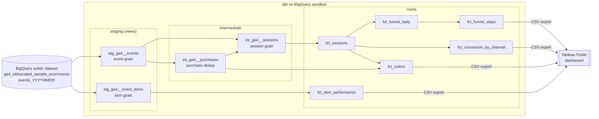

# GA4 E-commerce Analytics | BigQuery · dbt · Tableau

End-to-end analytics engineering project that turns raw Google Analytics 4 event
data into tested, analysis-ready data marts for e-commerce performance reporting.

It is built on Google's public GA4 e-commerce sample dataset (~4 million events).
The pipeline models user sessions, conversion funnels, acquisition channels,
transactions and product performance.

### Business objectives
- Find the conversion bottlenecks between viewing a product and purchasing it.
- Compare acquisition channels by traffic, conversion rate and revenue.
- Analyze purchasing behavior across devices and new vs returning users.
- Find products with high engagement but low add-to-cart conversion.

### Engineering highlights
- **Data transformation:** modular dbt models in staging, intermediate and mart layers.
- **Data modeling:** session-, transaction- and item-level fact tables, each with an explicit grain.
- **Data quality:** automated checks for uniqueness, completeness, referential integrity,
  funnel consistency, and exact revenue reconciliation between sessions and orders.
- **Analytics delivery:** Tableau-ready datasets for funnel, channel, device and product analysis.

**Data source:** Google Merchandise Store GA4 public sample,
`bigquery-public-data.ga4_obfuscated_sample_ecommerce` (Nov 2020 to Jan 2021).
The data is obfuscated. This project demonstrates analytics engineering methods,
not the store's real business performance.

## Architecture



| Model | Grain | Purpose |
|-------|-------|---------|
| `stg_ga4__events` | event | Flattens `event_params`, builds `session_key` |
| `stg_ga4__event_items` | event × item | Unnests the `items` array for e-commerce events |
| `int_ga4__purchases` | purchase event | Flags each purchase as `counted`, `duplicate` or `missing_transaction_id` |
| `int_ga4__sessions` | session | Session source, landing page, observed funnel events, order revenue |
| `fct_sessions` | session | Channel group, attribution basis, observed and inferred funnel flags |
| `fct_funnel_daily` | date × channel × device | Observed and inferred session counts per funnel step |
| `fct_funnel_steps` | date × channel × device × step | Long format for Tableau funnel charts |
| `fct_conversion_by_channel` | channel | Step conversion rates, AOV, revenue per session, traffic and revenue share |
| `fct_orders` | transaction | One row per counted transaction |
| `fct_item_performance` | item | Product funnel: views, carts, checkouts, units, revenue |

## Methodology

### Session attribution
| | |
|---|---|
| **Session key** | `md5(user_pseudo_id \|\| ga_session_id)`. `ga_session_id` is a timestamp and is not unique across users. Events with no `ga_session_id` are excluded from session models. |
| **Fields used** | The `source`, `medium` and `campaign` keys of `event_params`. These are session-scoped in the GA4 export. |
| **Rule** | The first event in the session (by timestamp) with a non-null source or medium sets the session's acquisition. |
| **Fallback** | If no event in the session logged a source or medium, the session is treated as `(direct) / (none)`, and `attribution_basis = 'no_source_logged'` records that this is a fallback, not an observation. |
| **Obfuscated values** | `<Other>` and `(data deleted)` go to an explicit `Unattributed (obfuscated)` channel instead of being merged into Direct. |
| **Not used** | `traffic_source.*` is the user's *first-touch* acquisition, which is fixed for every later session of that user. It is kept as `user_first_source` / `user_first_medium` for comparison. |
| **Known difference from the GA4 UI** | GA4's reports use last non-direct click with a lookback window across sessions. This model attributes each session on its own, with no lookback, so Direct will be higher than in the GA4 UI. |

[`analyses/attribution_check.sql`](analyses/attribution_check.sql) checks these
assumptions against the data:
- which events carry the params
- how many sessions have no source, or more than one
- how often session attribution differs from first touch

### Funnel: observed vs inferred
Steps: `session_start → view_item → add_to_cart → begin_checkout → purchase`.

- **Observed** (`has_<event>`, `sessions_observed`): GA4 logged that event in the session.
  These counts do not have to decrease from step to step. For example, a session can add
  to cart from a listing page without a `view_item` event.
- **Inferred** (`reached_<step>`, `sessions_inferred`): the session reached that step or
  a deeper one. A session that purchased is assumed to have passed checkout even if
  `begin_checkout` was not logged. This is an inference about progression, not observed
  checkout behavior. It is what makes the funnel monotonic, so step-to-step rates stay
  within 0–1.

The dashboard shows both counts side by side. The gap between them shows how much of
the funnel is inferred.

### Revenue and orders
GA4 can send the same purchase more than once, and some purchase events have no
`transaction_id` (null or `(not set)`). Deduplication happens in one place,
`int_ga4__purchases`:

| `purchase_status` | Meaning | Counts as an order / revenue? |
|---|---|---|
| `counted` | First purchase event for a `transaction_id` | Yes |
| `duplicate` | A later event repeating an already-counted `transaction_id` | No |
| `missing_transaction_id` | Cannot be deduplicated or joined to an order | No |

`fct_orders` and session revenue in `fct_sessions` both read only `counted` rows. So
they must **match exactly**: same number of transactions, and revenue equal to the cent.
The only orders excluded are those with no session. The test has no percentage
tolerance; the $0.01 slack only absorbs floating-point summation order.
[`analyses/revenue_bridge.sql`](analyses/revenue_bridge.sql) shows how much raw
purchase revenue falls into each status. That accounts for every dollar between raw
GA4 revenue and reported revenue.

## Data quality

| Check | Where |
|-------|-------|
| `unique` + `not_null` on every grain key (session, transaction, item, channel) | marts, intermediate |
| `unique_combination_of_columns` on funnel table grains | `fct_funnel_daily`, `fct_funnel_steps` |
| `accepted_values` on channel group, attribution basis, device, funnel step, purchase status | marts, intermediate |
| `accepted_range`: conversion rates in [0, 1]; revenue, durations, engagement ≥ 0 | marts, staging |
| Referential integrity: every order's session exists in `fct_sessions` | `fct_orders` |
| **Funnel consistency:** inferred counts never increase from one step to the next, for every date × channel × device | `tests/assert_funnel_is_monotonic.sql` |
| **Completeness:** session totals are identical across the three funnel models | `tests/assert_sessions_preserved_in_funnel.sql` |
| **Revenue reconciliation:** session revenue and transactions equal order revenue and transactions | `tests/assert_session_revenue_equals_order_revenue.sql` |

## Results

> Status: the pipeline has not yet been run end to end. This section will hold the
> output of `scripts/run_report.py`: models and tests run, any warnings with
> explanations, and row counts. It will also hold a screenshot of the dbt lineage graph.

## Findings

> To be written from [`analyses/headline_insights.sql`](analyses/headline_insights.sql)
> after the first full run (funnel drop-off, channel traffic vs revenue, device and
> new vs returning users, low view-to-cart products). Only numbers from those queries
> will be quoted here.

## Dashboard

> Tableau Public link and screenshot go here once published.
> Build guide: [docs/tableau_dashboard.md](docs/tableau_dashboard.md).

## Run it

### 1. BigQuery sandbox (free, no credit card)
1. Go to <https://console.cloud.google.com/bigquery>, sign in, and create a project.
   The sandbox is enabled automatically.
2. Note the project ID. The public dataset is in the **US** multi-region, so the dbt
   datasets must be in `US` too (the example profile sets this).
3. Sandbox limits: 1 TB of queries and 10 GB of storage per month, and tables expire
   after 60 days. The project uses only views and `CREATE OR REPLACE` tables, because
   the sandbox has no DML (MERGE/INSERT).

### 2. dbt
```bash
python3 -m venv .venv && source .venv/bin/activate
pip install -r requirements.txt
gcloud auth application-default login        # install the gcloud CLI first
cp profiles.yml.example profiles.yml         # then set `project:`
dbt deps
dbt debug
dbt build                                    # models + tests in DAG order
python scripts/run_report.py --project YOUR_GCP_PROJECT_ID > docs/run_report.md
dbt docs generate && dbt docs serve          # lineage graph for the screenshot
```
For a faster development loop, limit the run to one week of data:
```bash
dbt build --vars '{ga4_start_date: "20201201", ga4_end_date: "20201207"}'
```

### 3. Analyses and Tableau
```bash
dbt compile    # then run target/compiled/ga4_ecommerce/analyses/*.sql in the BigQuery console
python scripts/export_marts.py --project YOUR_GCP_PROJECT_ID
```
Build the dashboard in Tableau Public from the CSVs in `exports/`. Tableau Public cannot
connect to BigQuery directly.

## Caveats

This is an obfuscated sample: some source and medium values are redacted, some
`transaction_id`s are `(not set)`, and revenue is not real. Session attribution is an
approximation of GA4's (see above). Results show the method and should not be read as
findings about the real store.
