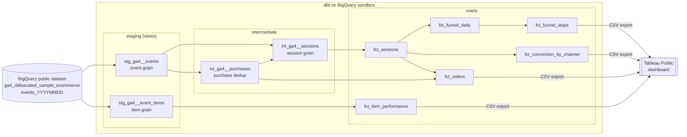

# GA4 E-commerce Analytics | BigQuery · dbt · Tableau

End-to-end analytics engineering project that turns raw Google Analytics 4 event
data into tested, analysis-ready data marts for e-commerce performance reporting.

It is built on Google's public GA4 e-commerce sample dataset (~4 million events).
The pipeline models user sessions, conversion funnels, acquisition channels,
transactions and product performance.

### Business objectives
- Find the conversion bottlenecks between viewing a product and purchasing it.
- Compare acquisition channels by traffic, conversion rate and revenue.
- Analyze purchasing behavior across devices and new vs returning users.
- Find products with high engagement but low add-to-cart conversion.

### Engineering highlights
- **Data transformation:** modular dbt models in staging, intermediate and mart layers.
- **Data modeling:** session-, transaction- and item-level fact tables, each with an explicit grain.
- **Data quality:** dbt tests for uniqueness, completeness, referential integrity, funnel
  consistency, exact revenue reconciliation between sessions and orders, and no double
  counting of item sales.
- **Analytics delivery:** Tableau-ready datasets for funnel, channel, device and product analysis.

> **Verification status:** the project compiles and every compiled SQL file parses as
> BigQuery SQL, but it has **not yet been run against BigQuery**. See
> [Verification status](#verification-status) for exactly what has and has not been checked.

**Data source:** Google Merchandise Store GA4 public sample,
`bigquery-public-data.ga4_obfuscated_sample_ecommerce` (Nov 2020 to Jan 2021).
The data is obfuscated. This project demonstrates analytics engineering methods,
not the store's real business performance.

## Architecture



| Model | Grain | Purpose |
|-------|-------|---------|
| `stg_ga4__events` | event | Flattens `event_params`, builds `session_key` |
| `stg_ga4__event_items` | event × item | Unnests the `items` array for e-commerce events |
| `int_ga4__purchases` | purchase event | Flags each purchase as `counted`, `duplicate` or `missing_transaction_id` |
| `int_ga4__sessions` | session | Session source, landing page, observed funnel events, order revenue |
| `fct_sessions` | session | Channel group, attribution basis, observed and inferred funnel flags |
| `fct_funnel_daily` | date × channel × device | Observed and inferred session counts per funnel step |
| `fct_funnel_steps` | date × channel × device × step | Long format for Tableau funnel charts |
| `fct_conversion_by_channel` | channel | Step conversion rates, AOV, revenue per session, traffic and revenue share |
| `fct_orders` | transaction | One row per counted transaction |
| `fct_item_performance` | item | Product funnel: views, carts, checkouts, units, revenue |

## Methodology

### Identifiers and placeholders
The sample's documentation says fields can hold `<Other>`, `NULL` or `''` because of
obfuscation. GA4 itself uses `(not set)`. For identifiers (`user_pseudo_id`,
`transaction_id`) all of these become NULL. Otherwise one placeholder such as `<Other>`
would merge many unrelated transactions into a single "order".

**Session key:** `sha256` of the JSON struct `{user_pseudo_id, ga_session_id}`.
- It is NULL unless both parts are present; events without them are excluded from the session models.
- JSON encoding is used instead of joining with a delimiter, so two different pairs can
  never produce the same key.
- `ga_session_id` alone is a start timestamp, so it is not unique across users.

### Session attribution (an approximation)
GA4 decides a session's attribution from the inputs on its `session_start` event
(UTMs, gclid, referrer), using **non-direct last click** across sessions. This 2020–21
export has no field holding that final result. The `session_traffic_source_last_click`
record was added to the export later; query 5 in `attribution_check.sql` checks whether
it exists. So this project reconstructs a per-session channel and labels it as an
approximation:

| | |
|---|---|
| **Fields used** | The `source`, `medium` and `campaign` keys of `event_params`, with blank values treated as NULL |
| **Rule** | Use the values on the session's `session_start` event. If it has none, use the earliest event in the session that logged a source or medium. |
| **`attribution_basis`** | Records which case applied: `session_start_params`, `other_event_params` or `not_logged` |
| **Missing ≠ Direct** | Sessions with nothing logged get the channel `Unattributed (not logged)`. `Direct` is used only when the session explicitly logged source `(direct)`. |
| **Obfuscated values** | `<Other>` and `(data deleted)` get the channel `Unattributed (obfuscated)` |
| **Not used for channel** | `traffic_source.*` is the user's *first-touch* acquisition and never changes for that user. It is kept as `user_first_source` / `user_first_medium`. |
| **Difference from GA4 reports** | No cross-session lookback. A session that GA4 would credit to an earlier non-direct channel appears here as Direct or Unattributed. |

[`analyses/attribution_check.sql`](analyses/attribution_check.sql) measures, on the real data:
- which events carry the params
- the `not_logged` share for each channel
- how often session attribution differs from first touch
- whether the export has GA4's session attribution fields

Until it has been run, treat channel results as provisional.

### New vs returning users
- `user_type` is `new` when GA4's `ga_session_number` = 1, `returning` when it is > 1,
  and `unknown` when GA4 sent no session number. Unknown sessions are never guessed as new.
- `ga_session_number` counts sessions for the `user_pseudo_id` since its first visit, even
  visits before this data window. So a user whose earlier visits fall before
  November 2020 is still correctly marked returning.
- **Limitations:**
  - `user_pseudo_id` identifies a browser/device cookie, not a person. A person on two
    devices counts as two users.
  - Clearing cookies makes a returning visitor look new.
  - Consent or obfuscation gaps can leave the number missing.
- `has_first_visit` (whether the session has a `first_visit` event) is kept for
  cross-checking. A warn-level test flags sessions with more than one session number.

### Funnel: observed vs inferred
Steps: `session_start → view_item → add_to_cart → begin_checkout → purchase`.

- **Observed** (`has_<event>`, `sessions_observed`): GA4 logged that event in the session.
  These counts do not have to decrease from step to step. For example, a session can add
  to cart from a listing page without a `view_item` event.
- **Inferred** (`reached_<step>`, `sessions_inferred`): the session reached that step or
  a deeper one. A session that purchased is assumed to have passed checkout even if
  `begin_checkout` was not logged. This is an inference about progression, not observed
  checkout behavior. It is what makes the funnel monotonic, so step-to-step rates stay
  within 0–1.

The dashboard shows both counts side by side. The gap between them shows how much of
the funnel is inferred.

### Revenue and orders
GA4 can send the same purchase more than once, and some purchase events have no usable
`transaction_id`. GA4 has no event ID, so each purchase row gets a `purchase_event_key`:
a hash of its user, timestamp, bundle sequence ID, `ecommerce` record and `items` array.
Deduplication happens in one place, `int_ga4__purchases`:

| `purchase_status` | Meaning | Counts as an order / revenue? |
|---|---|---|
| `counted` | Earliest row for a `transaction_id` (ties broken by `purchase_event_key`) | Yes |
| `duplicate` | Any other row with that `transaction_id`, including byte-identical copies | No |
| `missing_transaction_id` | NULL, `''`, `(not set)` or `<Other>`; cannot be deduplicated | No |

- **Precision:** the export stores money as FLOAT64. Revenue is cast to `NUMERIC` and
  rounded to cents in staging, so sums are exact and reconciliation needs no tolerance.
- **Missing revenue stays NULL**, not 0. A warn-level test reports counted orders without revenue.
- **One definition:**
  - Order and session revenue = `ecommerce.purchase_revenue_in_usd` of counted orders.
  - Item revenue = `items.item_revenue_in_usd` (price × quantity) of counted orders.
  - The two are different measures and are never added together or expected to be equal,
    because order revenue can include tax and shipping. `analyses/revenue_bridge.sql`
    measures the gap.
- **Orders without a session:** a purchase with no `ga_session_id` is still an order in
  `fct_orders`, with `has_session = false` and NULL channel and device. Only such orders
  are excluded from the session-revenue comparison.
- **Exact reconciliation test:** session transactions and revenue must equal those of
  orders that have a session, to the cent.
- **Consistency monitor (warn):** reports any `transaction_id` whose duplicate rows
  disagree on user or revenue. For those, "keep the earliest row" is a choice that changes
  revenue.

[`analyses/revenue_bridge.sql`](analyses/revenue_bridge.sql) breaks raw purchase revenue
down by status and session presence, and compares order revenue with item revenue.

### Item performance
- Views, add-to-carts and checkouts count **distinct sessions** per item, so repeated
  events in one session count once.
- Orders, units and revenue use only item lines from **counted** purchases. Each line
  (`purchase_event_key`, `item_index`) counts once, so duplicate purchase events and
  repeated rows cannot inflate item sales. A test checks the order counts against an
  independent count of distinct (item, counted transaction) pairs.

## Data quality

| Check | Where |
|-------|-------|
| `unique` + `not_null` on every grain key (session, transaction, item, channel) | marts, intermediate |
| `unique_combination_of_columns` on funnel table grains | `fct_funnel_daily`, `fct_funnel_steps` |
| `accepted_values` on channel group, attribution basis, user type, device, funnel step, purchase status | marts, intermediate |
| `accepted_range`: conversion rates in [0, 1]; revenue, durations, engagement ≥ 0 | marts, intermediate, staging |
| Referential integrity: every order's session exists in `fct_sessions` | `fct_orders` |
| **Funnel consistency:** inferred counts never increase from one step to the next, for every date × channel × device | `tests/assert_funnel_is_monotonic.sql` |
| **Completeness:** session totals are identical across the three funnel models | `tests/assert_sessions_preserved_in_funnel.sql` |
| **Revenue reconciliation:** session transactions and revenue equal those of orders with a session, exactly | `tests/assert_session_revenue_equals_order_revenue.sql` |
| **No item double counting:** item order counts equal distinct (item, counted transaction) pairs | `tests/assert_item_sales_use_counted_orders_only.sql` |
| Monitors (warn): duplicate purchases that disagree on user or revenue; counted orders without revenue; sessions with more than one session number; unexpected device values | tests + YAML |

## Verification status

| Check | How | Result |
|-------|-----|--------|
| dbt project parses (10 models, 64 tests, 3 analyses) | `dbt parse`, executed locally on dbt 1.12.7 | Passed, no warnings |
| All Jinja and macros render to SQL | `dbt compile --no-introspect`, executed locally with no warehouse connection | Passed, 77 compiled files |
| Compiled SQL is syntactically valid BigQuery | Every compiled file parsed with sqlglot's BigQuery dialect | Passed, 77/77. A parser cannot catch wrong column names or types. |
| Models build on BigQuery | `dbt build` | **Not run**: needs a GCP project |
| Data tests pass | `dbt build` | **Not run** |
| Attribution and revenue assumptions hold on the real data | `analyses/*.sql` | **Not run** |

Everything else in this README describes how the code is written (static code review),
not observed results. After the first `dbt build`, `scripts/run_report.py` adds the
real run evidence here: models and tests run, warnings with explanations, and row counts.

## Results

> Not yet available. Requires the first `dbt build` (see above).

## Findings

> To be written from [`analyses/headline_insights.sql`](analyses/headline_insights.sql)
> after the first full run (funnel drop-off, channel traffic vs revenue, device and
> new vs returning users, low view-to-cart products). Only numbers from those queries
> will be quoted here.

## Dashboard

> Tableau Public link and screenshot go here once published.
> Build guide: [docs/tableau_dashboard.md](docs/tableau_dashboard.md).

## Run it

### 1. BigQuery sandbox (free, no credit card)
1. Go to <https://console.cloud.google.com/bigquery>, sign in, and create a project.
   The sandbox is enabled automatically.
2. Note the project ID. The public dataset is in the **US** multi-region, so the dbt
   datasets must be in `US` too (the example profile sets this).
3. Sandbox limits: 1 TB of queries and 10 GB of storage per month, and tables expire
   after 60 days. The project uses only views and `CREATE OR REPLACE` tables, because
   the sandbox has no DML (MERGE/INSERT).

### 2. dbt
```bash
python3 -m venv .venv && source .venv/bin/activate
pip install -r requirements.txt
gcloud auth application-default login        # install the gcloud CLI first
cp profiles.yml.example profiles.yml         # then set `project:`
dbt deps
dbt debug
dbt build                                    # models + tests in DAG order
python scripts/run_report.py --project YOUR_GCP_PROJECT_ID > docs/run_report.md
dbt docs generate && dbt docs serve          # lineage graph for the screenshot
```
For a faster development loop, limit the run to one week of data:
```bash
dbt build --vars '{ga4_start_date: "20201201", ga4_end_date: "20201207"}'
```

### 3. Analyses and Tableau
```bash
dbt compile    # then run target/compiled/ga4_ecommerce/analyses/*.sql in the BigQuery console
python scripts/export_marts.py --project YOUR_GCP_PROJECT_ID
```
Build the dashboard in Tableau Public from the CSVs in `exports/`. Tableau Public cannot
connect to BigQuery directly.

## Caveats

This is an obfuscated sample: some source and medium values are redacted, some
`transaction_id`s are `(not set)`, and revenue is not real. Session attribution is an
approximation of GA4's (see above). Results show the method and should not be read as
findings about the real store.
